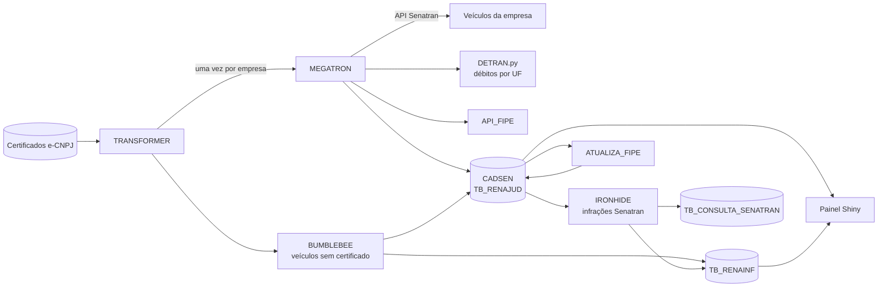

# Automação Senatran / DETRAN / FIPE

> **Repositório demonstrativo — só código.**
> Este é o código de uma automação que roda em produção numa distribuidora de
> bebidas, publicado para leitura. **Ele não roda sem os certificados digitais
> e os acessos reais**, que obviamente não estão aqui. Todos os dados do
> repositório (CNPJs, placas, RENAVAM, chassis, nomes de empresa, respostas de
> API) são **fictícios**.

## O problema

O grupo tem centenas de veículos (caminhões de entrega, utilitários, motos)
espalhados por várias filiais, em vários estados. Saber, todo mês, **quais
veículos cada CNPJ tem, quanto devem ao DETRAN (licenciamento, multas, IPVA),
se têm restrição judicial (RENAJUD) e quanto valem na tabela FIPE** era um
trabalho manual, portal por portal.

Esta automação monta essa "foto" mensal da frota sozinha e grava numa base que
alimenta um painel (app Shiny) usado pela gestão de frota.

## Os robôs

Os scripts têm nomes de Transformers — o "TRANSFORMER" é o orquestrador e cada
robô cuida de uma parte da coleta.

| Script | O que faz |
|---|---|
| `TRANSFORMER.py` | **Orquestrador.** Lê os certificados e-CNPJ (`.pfx`) da pasta `Certificados/`, descarta os vencidos, descobre a UF de cada empresa (BrasilAPI, com um mapa de reserva) e, para cada empresa marcada como ativa no dia, executa o MEGATRON. |
| `MEGATRON.py` | **Robô principal.** Com o certificado da empresa, lista os veículos dela no Senatran (`meus-veiculos-posse`, paginado), detalha cada um (`meus-veiculos-comp`: tipo, modelo, ano, chassi, restrições, RENAJUD), busca o código FIPE, chama o `DETRAN.py` para os débitos e grava uma linha por veículo na tabela `CADSEN`. Processos judiciais vão para `TB_RENAJUD`. |
| `OPTIMUS PRIME.py` | **Versão anterior / reserva do MEGATRON**, hoje desligada no TRANSFORMER. Faz a mesma coleta, mas **raspando o portal do Senatran com navegador** (pydoll + pyautogui para escolher o certificado no seletor do Windows). Fica no repositório porque é o plano B quando a API cai. |
| `DETRAN.py` | **Biblioteca de consultas estaduais.** Uma função `debito_XX` por UF (PE, AL, MA, CE, RJ, RN, PI, PB, SP, MG, ES, ...). Algumas usam API paga, outras raspam o site do DETRAN/SEFAZ com Selenium/pydoll, e algumas resolvem captcha com OCR (Tesseract ou o `image2text.R`). Devolve débito total, licenciamento, multas, IPVA e custo da consulta. |
| `BUMBLEBEE.py` | **Veículos sem certificado.** O Senatran só responde ao dono do e-CNPJ; veículo de empresa sem certificado nunca entraria na foto. O BUMBLEBEE consulta esses veículos direto no DETRAN estadual (hoje PI) e grava a **mesma** linha do `CADSEN`, na mesma data da rodada, mais as infrações em `TB_RENAINF`. Tem `--simular`, `--placa` e `--json-teste`. |
| `IRONHIDE.py` | **Infrações (RENAINF).** Para cada empresa, pega as placas da última foto e consulta `senatran/infracoes` em paralelo (10 threads). Grava as infrações em `TB_RENAINF` (uma linha por execução enquanto a multa está aberta, para manter o histórico) e o resultado de cada consulta em `TB_CONSULTA_SENATRAN`. O detalhe da infração (local, data/hora, prazo de indicação do condutor) é uma chamada paga à parte — só é feito para infração **inédita**; as demais copiam o detalhe de execuções anteriores. |
| `ATUALIZA_FIPE.py` | **FIPE.** Para todos os veículos da foto do dia, busca código FIPE, mês de referência e preço e atualiza o `CADSEN`. |
| `API_FIPE.py` | Função de apoio: padroniza o tipo do veículo e consulta o webhook interno que devolve o código FIPE. |
| `image2text.R` | OCR dos captchas de texto de alguns DETRANs (ES, PI, PA, MS), chamado pelo `DETRAN.py` via `Rscript`. |
| `rodar_producao.ps1` | Roda o ciclo completo na ordem certa, mostrando a saída na tela e gravando log geral + log de erros. |

## Fluxo



Ordem do `rodar_producao.ps1`:

```
TRANSFORMER.py  ->  BUMBLEBEE.py  ->  IRONHIDE.py  ->  ATUALIZA_FIPE.py
```

- O **BUMBLEBEE** roda depois do TRANSFORMER porque precisa gravar na mesma
  `DTA_EXEC` da foto do mês, e antes do ATUALIZA_FIPE para ganhar a FIPE de graça.
- O **IRONHIDE** usa a foto recém-gravada para saber quais placas consultar e
  exclui as placas do BUMBLEBEE (com o certificado de outra empresa a consulta
  é paga e volta vazia).
- `empresas_ativas.csv` / `empresas_ativas_ironhide.csv` (criados na primeira
  execução) permitem marcar quais empresas rodam no dia — há empresas que rodam
  uma vez por mês e outras duas. Exemplo em `exemplos/empresas_ativas.exemplo.csv`.

## Alguns cuidados que estão no código

- **"Não consegui perguntar" não é "não tem multa".** Várias funções do DETRAN
  zeram tudo quando a consulta falha; por isso o IRONHIDE só pula placa com
  multa zero quando dá para provar que o DETRAN respondeu (custo da API > 0) e
  a foto é recente. Campos que o DETRAN não informa ficam vazios, e não "Não".
- **Idempotência:** rodar duas vezes no mesmo dia não duplica nada
  (dedup por `PLACA + DTA_EXEC` no `CADSEN` e `PLACA + AUTO_INFRACAO + DTA_EXEC`
  no `TB_RENAINF`).
- **Custo:** chamadas pagas só quando necessárias (detalhe de infração inédita,
  repetição só para erro de indisponibilidade — erro de parâmetro não se repete).
- **Certificado criptografado:** o `.pfx` e a senha vão para a API cifrados com
  AES-256.

## Estrutura

```
.
├── TRANSFORMER.py / MEGATRON.py / OPTIMUS PRIME.py / DETRAN.py
├── BUMBLEBEE.py / IRONHIDE.py / ATUALIZA_FIPE.py / API_FIPE.py / image2text.R
├── config.py               # obter_credencial(): ponto único de leitura de segredos
├── armazenamento.py        # camada Parquet (substitui o MySQL nesta versão)
├── rodar_producao.ps1
├── .env.exemplo
├── Certificados/           # vazia (só LEIA-ME); certificados nunca são versionados
├── dados/
│   ├── gerar_dados_ficticios.py
│   └── *.parquet           # CADSEN, TB_RENAINF, TB_RENAJUD, TB_CONSULTA_SENATRAN,
│                           # TB_VEICULO_SEM_CERT, TB_EMPRESAS — fictícios
└── exemplos/
    ├── resposta_senatran_infracoes_ficticia.json   # formato do senatran/infracoes
    ├── resposta_detran_pi_veiculo_ficticia.json    # formato do detran/pi/veiculo (BUMBLEBEE)
    └── empresas_ativas.exemplo.csv
```

## Diferenças em relação à produção

- **Banco:** em produção os robôs gravam num MySQL/MariaDB. Aqui cada tabela é
  um arquivo Parquet em `dados/`, com **as mesmas colunas**, e as operações
  (`INSERT ... WHERE NOT EXISTS`, `UPDATE`, `DELETE`, `ON DUPLICATE KEY UPDATE`)
  foram reproduzidas com pandas em `armazenamento.py`. Os comentários no código
  indicam qual era o SQL original.
- **Segredos:** nenhum fica no código. Token da API, chave de criptografia,
  senhas de certificado e login de portal são pedidos por
  `obter_credencial(nome)`, em `config.py`, que por padrão lê a variável de
  ambiente de mesmo nome e pode ser trocada para ler de um cofre de senhas.
  CNPJs das filiais e URL do webhook FIPE são configuração, com padrões fictícios.
- **Caminhos** absolutos da máquina viraram relativos ou variáveis de ambiente.
- Fora daqui: certificados, respostas reais da API, logs, planilhas de controle
  e um script auxiliar de imagens de modelos que não faz parte do ciclo.

## O que seria preciso para rodar de verdade

1. **Certificado digital e-CNPJ A1** (`.pfx`) de cada empresa, válido, na pasta
   `Certificados/`, e as senhas disponíveis para `obter_credencial()`. O Senatran só mostra os veículos do
   dono do certificado.
2. **Conta e token na API de consultas** (Infosimples) com os serviços do
   Senatran, DETRANs e SEFAZ contratados — as consultas são pagas.
3. Os **CNPJs reais** das filiais e a UF de cada uma (`.env`), o login do
   portal do DETRAN-RN e a URL do webhook FIPE.
4. Windows com **sessão de desktop ativa e desbloqueada** (o OPTIMUS PRIME e
   parte do DETRAN.py usam pyautogui para escolher o certificado e digitar em
   sites), Google Chrome, Tesseract-OCR e R com os pacotes `tesseract`, `magick`
   e `png`.
5. `pip install -r requirements.txt`, configurar as credenciais com os nomes
   listados em `.env.exemplo` (ou adaptar `obter_credencial()`) e rodar
   `rodar_producao.ps1`.

Sem isso, o máximo que dá para fazer é ler o código, abrir os Parquet de
exemplo (`pandas.read_parquet("dados/CADSEN.parquet")`) e regerá-los com
`python dados/gerar_dados_ficticios.py`.

## Tecnologias

Python (pandas, requests, Selenium, pydoll, pyautogui, cryptography,
pytesseract), R (tesseract/magick) para OCR, API REST de consultas veiculares,
BrasilAPI (CNPJ e FIPE), Parquet/pyarrow nesta versão (MySQL em produção),
PowerShell para agendamento e logs.
